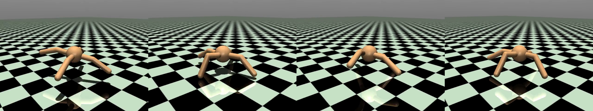

# 四足机器人强化学习训练（MuJoCo Ant + PPO）



一个在笔记本上跑出来的四足行走策略。12 秒视频（点开看）：[rollout_chase.mp4](rollout_chase.mp4)

---

## 先说做了啥

想让一个四足机器人在仿真里学会往前走，能按给定的速度走更好。

最后的结果是：**训练 120 万步，策略能连续走 12 秒、前进 22.8 米，平均速度 1.9 m/s，中途不摔**。但得说清楚——**按我原本的目标（速度跟踪）它没做到**，现在这版跑的是 Gymnasium 自带的 Ant 奖励，只是"会走"，还不会"按指令走"。

训练是在这台笔记本上纯 CPU 跑的，没上显卡。

## 为什么是 MuJoCo 不是 Isaac Lab

我显卡是 RTX 3050 Laptop，只有 **4GB 显存**，Isaac Sim 官方建议 8GB 起步。装是装上过，官方 example 也跑通了，但真要开训练环境数一上去就爆显存，所以先拿 MuJoCo 把训练→评测→视频这条链路走通。

MuJoCo 的 Ant 也是标准四足 benchmark，奖励设计和训练流程跟 Isaac Lab 里那套是一个思路，以后有条件搬过去不用重学。

## 结果

```json
{
  "mean_vx_m_s": 1.902,
  "max_vx_m_s": 4.153,
  "distance_m": 22.82,
  "duration_s": 12.0,
  "mean_torso_height_m": 0.531,
  "survived_full": true
}
```

训练曲线（return）：−70 → 2.6 → 122 → 500 → **1172**，ep_len 从 166 涨到 600~890 之后基本稳住。CPU 19 线程，每秒 1~2 千步，120 万步大约 20 分钟。

## 踩坑：奖励改了四版，全废了

这部分是这个项目里最值得记的东西，因为它比"顺利跑通"更有信息量。

我最初的想法很简单：给一个前向速度的高斯核奖励，设个目标速度，让它自己学。然后连改了四版：

| 版本 | 奖励构成 | 结果 | 我当时的判断 |
|---|---|---|---|
| v1 | 存活 1.0 + 高斯跟踪 2.0 | ep_len 跑满 1001 步，但 vx≈0、track 0.03 | 站住了。不动也能拿约 1.0/步，走路并没有明显更划算 |
| v2 | 加前进项 1.5 + 跟踪 2.0 | vx 冲到 1.3~1.7，但 ep_len 只剩 30~90 | 扑街式前进——它发现摔之前冲一把能刷分 |
| v2b | 存活提到 2.5，前进 1.0，加直立 0.5 | ep_len 回到 941，vx 掉到 0.19 | 存活权重给太高，又一次压倒一切，回到站立 |
| v3 | 存活 1.0 + 前进 2.0 + 跟踪 2.0 + 直立 1.0 | 中段 vx 0.54，最后 vx -0.09 | 还是站立。说明光调权重不行，问题在结构上 |

连着四版都往"站住"收敛的时候，我第一反应是怀疑自己 PPO 写错了。但改 PPO 之前，我先做了个对照实验：把奖励换成 Gymnasium Ant-v5 自带的原生奖励，代码一行不动，只换奖励函数。

结果一次就学出了走路。

所以问题不在实现，在我自己设计的奖励：

1. 存活奖励和移动奖励在这类任务里是直接竞争关系，权重怎么给，基本决定了策略落在"站"还是"走"；
2. 用线性速度项催前进，策略很容易找到"不稳定但能刷分"的姿势（摔倒前冲），而不是学出稳定步态；
3. 原生奖励里 contact、survival、control 这些 shaping 项是有人调过的配方，先用它跑通闭环、再在上面叠跟踪项，比从零自己造划算得多。

**顺手记一条方法论**：怀疑自己实现有问题之前，先用一个已知能收敛的配置跑一遍。对照组比看多少篇博客都管用。

## 实现

PPO 是自己写的，没用 sb3：

- 向量化采样：`SyncVectorEnv` × 16 环境，rollout 256 步，minibatch 1024
- clip 0.2、γ 0.99、GAE λ 0.95、entropy 系数 0（原生奖励这版）、Adam lr 3e-4
- actor/critic 各两层 256 的 tanh，actor 末层正交初始化 std=0.01，log_std 学习
- advantage 归一化、梯度裁剪 max_norm=0.5、value loss 系数 0.5

渲染也踩了个坑：`mjv_defaultFreeCamera` 是钉在原点上的，机器人跑出十几米之后就只剩个点，视频里看不见。换成 `mjCAMERA_TRACKING` 跟着 torso 才正常。

## 跑起来

```powershell
pip install mujoco gymnasium torch imageio-ffmpeg

# 原生奖励版本（就是现在能走的这个）
python train_standard.py --steps 1200000 --tag ant_standard

# 我自己设计的奖励（记录失败过程用的，看看它怎么站住不动）
python train.py --steps 400000 --tag probe4

# 出视频和指标
python render_chase.py --run runs/ant_standard --seconds 12 --out rollout_chase
```

训练好的权重已经提交在 `runs/ant_standard/policy.pt`，不训练也能直接渲染：

```powershell
python render_chase.py --run runs/ant_standard
```

## 接下来想做的

现在这版只会往前跑，还不会按速度走。想这么改：

1. 不替换原生奖励，在上面**叠**一个速度跟踪项，权重从小往大加，看看在哪一档开始学崩；
2. 课程学习，目标速度 0.3 → 0.6 → 1.0 → 1.5，一档训稳再往上提；
3. critic 给特权信息（接触力、真实摩擦系数），试试能不能把样本效率提上去；
4. 加地形随机化和外力扰动，看它摔不摔；
5. 有条件了搬去 Isaac Lab，跟 MuJoCo 上的策略做 sim2sim 对比。

第 1、2 步做完，"可调速"才算真的立住。

## 这不是什么

不是论文复现，不是在真机上跑的，也没做过 sim2real。就是一个在 4GB 显存的笔记本上把四足 RL 训练闭环走通的练习，顺便把走过的弯路记下来。

## 仓库

<https://github.com/sunsunsuns/quadruped-locomotion-rl>

```bash
git clone git@github.com:sunsunsuns/quadruped-locomotion-rl.git
cd quadruped-locomotion-rl
pip install mujoco gymnasium torch imageio-ffmpeg
python render_chase.py --run runs/ant_standard
```
